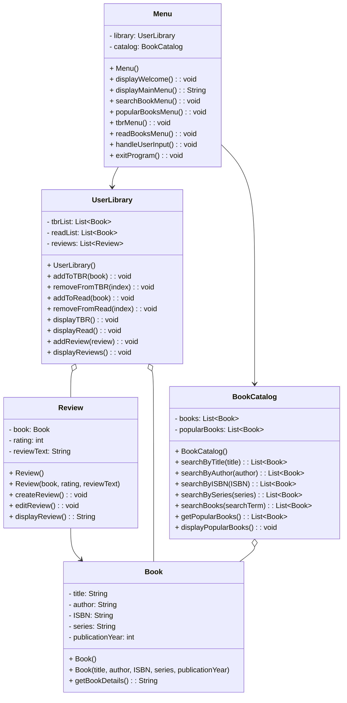

# CS121 FINAL PROJECT

## Inspired by good reads
```
I am an avid reader and immediatly thought about this as the project I was goind to do when the project came up

This project is a simple CLI based good reads replica.
It will have basic functions such as searching for books, adding and removing books from your TBR's (to be read lists) and already read lists. 
You will also be able to leave star'd and written reviews on the books that you search. 
This project is meant for book lovres if they want to keep a local library of the books they want to read or have already read. 
I will be needing to implement an api to make these searches possible from the CLI to the internet.
```


## mermaid live diagram

